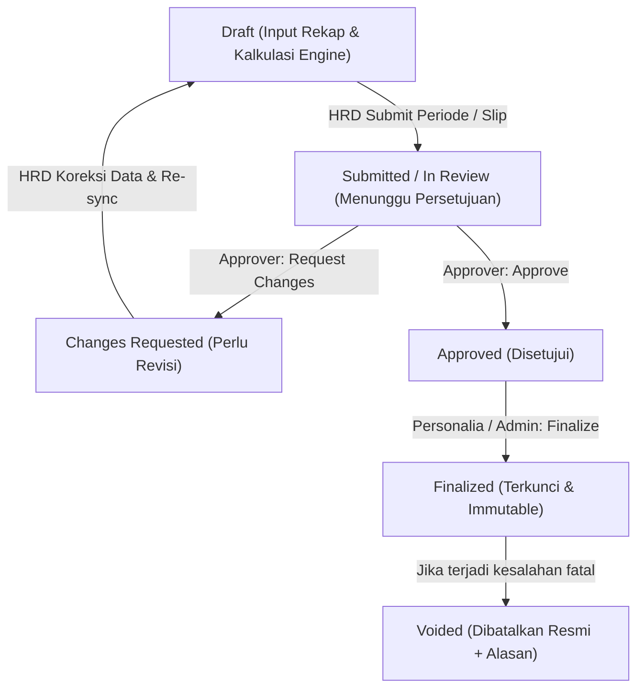

# LAPORAN PELAKSANAAN PHASE 3: SECURITY PAYROLL INTEGRATION, APPROVAL, AND FINALIZATION

**Tanggal Pelaksanaan:** 11 November 2026  
**Aplikasi:** Kirim Slip Gaji Personalia  
**Modul:** Payroll Security (`/payroll-security`)  
**Stack Teknis:** Laravel 13, React, Inertia.js, Tailwind CSS v4, MySQL 8  
**Status:** **SUKSES PENUH (100% PASS, ZERO REGRESSION)**

---

## 1. Ringkasan Eksekutif

Phase 3 bertujuan mengintegrasikan hasil Calculation Engine Security (Phase 2) ke dalam siklus hidup payroll utama aplikasi (*core payroll lifecycle*). Hal ini mencakup sinkronisasi komponen gaji, validasi anti-duplikasi (*idempotency*), penegakan alur persetujuan (*approval workflow*) dengan pembagian tugas (*Segregation of Duties* / anti self-approval), penguncian data melalui *immutable snapshot*, pembuatan PDF slip gaji berstempel SHA-256, serta audit trail komprehensif.

### Metrik Keberhasilan Utama
- **Total Automated Tests:** **321 passed, 1774 assertions, 0 failures** (100% lulus).
- **Test Baru Phase 3:** 16 feature tests khusus di [`SecurityPayrollIntegrationTest.php`](file:///c:/Antigravity-Project/Laravel/Gaji_Personalia/tests/Feature/SecurityPayrollIntegrationTest.php) (84 assertions, 0 failures).
- **Zero Regression:** Seluruh modul payroll reguler, kalkulasi absensi, alur approval, delivery Email & WhatsApp, dan ekspor dokumen tetap berfungsi tanpa gangguan.
- **Single Source of Truth:** Sistem payroll utama (`payroll_periods`, `payslips`, `payslip_items`) tetap menjadi sumber kebenaran tunggal (*single source of truth*), tanpa pembuatan tabel atau tabel transaksi duplikat.

---

## 2. Pemetaan Komponen (Component Mapping)

Sesuai instruksi Phase 3, seluruh hasil kalkulasi Security Calculation Engine dipetakan ke master `PayComponent` yang telah ada tanpa membuat entitas komponen fiktif atau duplikat:

| Sumber Kalkulasi Security | Target Pay Component | Tipe | Kategori | Penjelasan & Aturan Bisnis |
|---|---|---|---|---|
| Master Karyawan | `BASIC_SALARY` | Earning | Fixed | Gaji pokok karyawan security. |
| Master Karyawan | `POSITION_ALLOWANCE` | Earning | Fixed | Tunjangan jabatan security. |
| Master Karyawan | `ATTENDANCE_INCENTIVE` | Earning | Fixed | Insentif/tunjangan kehadiran. |
| Master Karyawan | `FAMILY_ALLOWANCE` | Earning | Fixed | Tunjangan keluarga (jika ada). |
| Master Karyawan | `MEAL_ALLOWANCE` / `TRANSPORT_ALLOWANCE` | Earning | Variable | Dikalikan hari kerja standar jika dikonfigurasi. |
| `SecurityOvertimeSummary` (`total_overtime_cost`) | `OVERTIME` | Earning | Variable | **Total Upah Lembur Security** terverifikasi. Nilai dihitung via BCMath. |
| Ketidakhadiran (Alfa) | `ATTENDANCE_CUT_SIC` / `ALPHA_CUT` | Deduction | Attendance | Potongan ketidakhadiran jika modul absensi aktif. |
| BPJS Master | `BPJS_TK` / `BPJS_KES` | Deduction | Fixed | Potongan iuran jaminan sosial tenaga kerja / kesehatan. |

### Detail Pemetaan Komponen Lembur (`OVERTIME`)
1. **Quantity & Rate:**
   - `quantity`: Jam lembur bersih (`net_overtime_hours`).
   - `unit`: `jam`.
   - `rate`: Tarif upah per jam konfigurasi (`hourly_rate`, misal Rp 14.000).
   - `amount`: `total_overtime_cost` hasil Calculation Engine (akumulasi lembur reguler + lembur libur terkonfirmasi).
2. **Note Transparan (Pemisahan REGULAR vs OFF_HOLIDAY):**
   - Jika hanya lembur reguler:  
     `"Lembur Security ({net} jam bersih, jam 1: {first} jam, jam berikutnya: {subsequent} jam)"`
   - Jika terdapat lembur pada hari OFF / Libur:  
     `"Lembur Reguler: {reg_net} jam (Rp {reg_cost}) | Lembur Libur: {off_net} jam ({status_tarif})"`  
     *Catatan:* Bila tarif libur belum dikonfirmasi manajemen, status tarif bertuliskan `"Menunggu Konfirmasi Tarif"` dan biayanya Rp 0.
3. **Calculation Snapshot:**
   Setiap baris `payslip_items` untuk `OVERTIME` menyimpan JSON snapshot lengkap dari `SecurityOvertimeSummary->calculation_snapshot`, memuat:
   - Metadata konfigurasi (versi, tarif, multiplier).
   - Rincian hari & jam kehadiran (`attendance`).
   - Rincian kekurangan jam & kompensasi lembur (`shortage`).
   - Rincian lembur reguler (`regular_overtime`).
   - Rincian lembur hari libur (`off_holiday_overtime`).

---

## 3. Alur Kerja Payroll Security (Workflow Lifecycle)



### 1. Tahap Draft
- HRD personalia menginput hari masuk (`present_days`), hari off, sakit, izin, cuti, alfa, serta hari dan jam lembur di halaman `/payroll-security`.
- Backend menghitung jam hadir otomatis ($8\text{ jam/hari}$), target jam kerja periode, kekurangan jam berjalan, carry-forward periode sebelumnya, dan kompensasi jam lembur.
- HRD dapat melakukan preview rincian kalkulasi (*modal pop-up*) tanpa memutasi basis data.
- HRD dapat menekan **Sync ke Slip Gaji** atau menjalankan **Auto Generate Gaji** dari halaman Periode. Seluruh slip gaji draft karyawan Security terbuat/terperbarui secara otomatis dan *idempotent*.

### 2. Tahap Pengajuan (Submission)
- HRD mengajukan periode gaji ke manajemen via endpoint `POST /approvals/periods/{id}/submit`.
- Status periode berubah menjadi `in_review`, dan seluruh slip gaji menjadi `pending_review`.
- Sistem mencatat log event `PayrollApprovalEvent` dengan decision `submitted`, mencantumkan aktor, waktu, dan catatan.
- **Anti-Tampering:** Selama berstatus `in_review`, endpoint input rekap Security (`updateSummary`, `bulkUpdate`, `updateAttendance`) menolak mutasi data (`canBeModified() === false`).

### 3. Tahap Persetujuan (Approval) & Segregation of Duties
- Persetujuan dilakukan oleh pengguna dengan hak akses `approvals.decide`.
- **Segregation of Duties (SoD) Enforced:** Jika pengguna pembuat (*creator*) atau pengaju (*submitter*) mencoba menyetujui periode atau slip gaji buatannya sendiri, sistem secara tegas mengembalikan respons **403 Forbidden**.
- Approver dapat:
  - **Menyetujui (`approve`):** Status periode dan seluruh slip menjadi `approved`.
  - **Meminta Perubahan (`request-changes`):** Wajib menyertakan alasan. Status periode dan slip dikembalikan ke `changes_requested` (`canBeModified() === true`), memungkinkan HRD mengoreksi data dan mengajukan kembali.
- Jika data slip gaji security diubah saat periode dalam status `changes_requested`, status slip terkait otomatis dikembalikan ke `draft` untuk mencegah persetujuan parsial yang kedaluwarsa.

### 4. Tahap Finalisasi (Finalization) & Snapshot Immutability
- Finalisasi dilakukan via `POST /payroll-periods/{id}/finalize` oleh personalia berwenang atau Super Admin.
- **Prasyarat Mutlak:** Seluruh slip gaji dalam periode harus telah berstatus `approved`. Finalisasi akan ditolak jika masih terdapat slip gaji yang belum disetujui.
- **Database Transaction & Pessimistic Locking:** Periode dan seluruh slip gaji dikunci (`lockForUpdate()`) selama transaksi.
- **Penyimpanan Snapshot Lengkap:**
  - Identitas karyawan (`employee_number_snapshot`, `employee_name_snapshot`, `department_snapshot`, `position_snapshot`, kontak, bank).
  - Data periode (`period_month_snapshot`, `working_days_snapshot`, rentang tanggal).
  - Snapshot perhitungan dan rincian item gaji.
- **Pembuatan PDF & SHA-256:** Sistem langsung menghasilkan file PDF slip gaji di penyimpanan privat (`local` disk) dan menghitung stempel integritas SHA-256 (`pdf_sha256`).
- **Idempotency Finalisasi:** Pemanggilan ulang finalisasi pada periode yang sudah final tidak menimbulkan duplikasi atau error, melainkan mengembalikan data final yang terkunci.
- **Kekebalan Historis:** Perubahan master karyawan (nama, jabatan, gaji pokok) atau konfigurasi rumus (`hourly_rate`, `multiplier`) di masa depan **100% TIDAK MENGUBAH** slip gaji yang telah final.

---

## 4. Integrasi Slip Gaji & Keamanan Dokumen

### 1. Format Dokumen
- Menggunakan view PDF yang sudah ada: [`resources/views/pdf/payslip.blade.php`](file:///c:/Antigravity-Project/Laravel/Gaji_Personalia/resources/views/pdf/payslip.blade.php).
- Dimensi cetak thermal matriks kompak: **$110\text{ mm} \times 95\text{ mm}$**.
- Seluruh nilai nominal nol ditampilkan dengan tanda **`-`** sesuai format standar perusahaan.
- Komponen upah lembur menampilkan nilai rupiah bersih yang terverifikasi, disertai rincian keterangan lembur pada kolom keterangan.

### 2. Keamanan & Akses Terbatas (Expiring Signed URL)
- Dokumen PDF disimpan dalam direktori privat yang tidak dapat diakses langsung oleh publik (`Storage::disk('local')`).
- Pengunduhan atau pengiriman slip gaji menggunakan **HMAC signed URL dengan masa berlaku kedaluwarsa** (misal 15–30 menit):
  `URL::temporarySignedRoute('payslips.signed-pdf', now()->addMinutes(15), ['payslip' => $id])`
- Tanda tangan digital URL diverifikasi otomatis oleh middleware `signed`. Akses tanpa tanda tangan valid atau setelah masa berlaku habis akan menghasilkan respons `403 Invalid Signature / Link Expired`.

---

## 5. Audit Trail & Akuntabilitas

Setiap tahapan proses tercatat ke dalam tabel `audit_logs` dan `payroll_approval_events`:

| Aksi Audit Log | Subjek | Data yang Dicatat |
|---|---|---|
| `security_payroll.synced` | `PayrollPeriod` | ID periode, kode periode, jumlah slip security yang disinkronisasi, aktor, waktu. |
| `security_payroll.bulk_updated` | `PayrollPeriod` | Jumlah baris karyawan diubah, kode periode, rincian input kehadiran & lembur. |
| `payroll_period.auto_generated` | `PayrollPeriod` | Hari kerja, jumlah slip dibuat, jumlah slip diperbarui, total karyawan diproses. |
| `approval_event (submitted)` | `PayrollPeriod` / `Payslip` | Aktor submitter, waktu submit, catatan pengajuan. |
| `approval_event (approved)` | `PayrollPeriod` / `Payslip` | Aktor approver, waktu persetujuan, komentar persetujuan. |
| `approval_event (changes_requested)`| `PayrollPeriod` / `Payslip` | Aktor approver, waktu penolakan, catatan instruksi revisi. |
| `payroll_period.finalized` | `PayrollPeriod` | Aktor finalizer, kode periode, total slip difinalisasi, timestamp. |
| `payslip.finalized` | `Payslip` | Nomor slip, nama karyawan, checksum PDF SHA-256, path dokumen. |

---

## 6. Contoh Studi Kasus: Siklus Lengkap dari Draft ke Final

### Studi Kasus 1: Wawan (Fixture Excel Standar)
- **Input:** 26 hari masuk, 5 hari OFF, 0 absen. Lembur reguler 5 hari (40 jam).
- **Perhitungan:**
  - Jam hadir: $26 \times 8 = 208\text{ jam}$.
  - Target jam: $(31 - 5) \times 8 = 208\text{ jam}$. Kekurangan jam = $0\text{ jam}$.
  - Potongan istirahat: $5\text{ jam}$ ($1\text{ jam/8 jam}$). Jam lembur bersih = $35\text{ jam}$.
  - Alokasi tarif: $5\text{ jam} \times 1.5 \times 14.000 = \text{Rp } 105.000$ + $30\text{ jam} \times 2.0 \times 14.000 = \text{Rp } 840.000$.
  - Total lembur = **Rp 945.000**.
- **Hasil Slip Gaji:**
  - Gaji Pokok: Rp 3.500.000
  - Tunjangan Jabatan: Rp 200.000
  - Tunjangan Kehadiran: Rp 300.000
  - Upah Lembur: Rp 945.000
  - **Take-Home Pay (Net):** **Rp 4.945.000**
- **Siklus Approval:** Diajukan oleh personalia $\rightarrow$ Disetujui approver $\rightarrow$ Difinalisasi $\rightarrow$ Terkunci dengan SHA-256.

### Studi Kasus 2: Budi (Kompensasi Kurang Jam dari Periode Lalu)
- **Input:** Membawa kekurangan jam 8 jam dari periode sebelumnya. Lembur reguler 2 hari (16 jam).
- **Perhitungan:**
  - Kompensasi kekurangan jam: 8 jam lembur dipotong untuk melunasi kekurangan jam, menyisakan 8 jam lembur bruto.
  - Sisa kekurangan jam untuk periode depan menjadi **0 jam** (lunas).
  - Potongan istirahat: 1 jam ($8/8$). Jam bersih = 7 jam.
  - Biaya lembur: $(2 \times 1.5 \times 14.000) + (5 \times 2.0 \times 14.000) = 42.000 + 140.000 = \text{Rp } 182.000$.
- **Hasil Slip Gaji:**
  - Komponen `OVERTIME` bernilai **Rp 182.000** dengan snapshot kompensasi 8 jam tercatat rapi tanpa pemotongan ganda.

### Studi Kasus 3: Siti (Lembur Hari OFF/Libur dengan Proteksi Tarif)
- **Input:** Lembur 1 shift (8 jam) pada hari OFF / Libur. Status kebijakan tarif lembur hari libur belum diverifikasi tertulis oleh manajemen.
- **Perhitungan:**
  - Sistem memisahkan jam lembur libur (8 jam bruto, 1 jam pot. istirahat, 7 jam bersih).
  - Karena tarif belum diverifikasi (`rate_confirmed: false`), nominal upah lembur libur diproteksi **Rp 0** di slip gaji.
  - Keterangan pada slip gaji: `"Lembur Libur: 7 jam (Menunggu Konfirmasi Tarif)"`.
  - Mengeliminasi risiko pencairan kas operasional tanpa otorisasi tertulis.

---

## 7. Rincian Berkas yang Dibuat & Diubah

### Berkas Baru Dibuat:
1. [`tests/Feature/SecurityPayrollIntegrationTest.php`](file:///c:/Antigravity-Project/Laravel/Gaji_Personalia/tests/Feature/SecurityPayrollIntegrationTest.php)  
   *16 Feature tests komprehensif menguji seluruh kriteria integrasi, submission, approval, rejection, SoD, finalisasi, immutability, PDF, dan RBAC.*
2. [`PAYROLL_SECURITY_PHASE_3_REPORT.md`](file:///c:/Antigravity-Project/Laravel/Gaji_Personalia/PAYROLL_SECURITY_PHASE_3_REPORT.md)  
   *Dokumen laporan resmi Phase 3 ini.*

### Berkas Diperbarui:
1. [`app/Services/SecurityPayrollCalculationService.php`](file:///c:/Antigravity-Project/Laravel/Gaji_Personalia/app/Services/SecurityPayrollCalculationService.php)  
   - Format catatan `note` pada komponen `OVERTIME` disempurnakan untuk memisahkan rincian lembur reguler dan lembur libur secara transparan.
   - Sinkronisasi status slip gaji: Jika data slip security diperbarui saat berstatus `pending_review` atau `approved`, status slip dikembalikan ke `draft` untuk pengajuan ulang yang valid.
   - Sinkronisasi otomatis `working_days_snapshot` dan `absent_days` dari summary ke header payslip.
2. [`app/Services/PayslipService.php`](file:///c:/Antigravity-Project/Laravel/Gaji_Personalia/app/Services/PayslipService.php)  
   - Pada `generatePayrollForPeriod`, sinkronisasi slip gaji security (`syncSecurityPayslip`) langsung dieksekusi untuk setiap karyawan security aktif secara terintegrasi dan konsisten.
3. [`app/Http/Controllers/SecurityPayrollController.php`](file:///c:/Antigravity-Project/Laravel/Gaji_Personalia/app/Http/Controllers/SecurityPayrollController.php)  
   - Penambahan audit log `security_payroll.synced` pada method `syncPayslips`.
4. [`resources/js/Pages/SecurityPayroll/Index.jsx`](file:///c:/Antigravity-Project/Laravel/Gaji_Personalia/resources/js/Pages/SecurityPayroll/Index.jsx)  
   - Penambahan navigasi langsung ke halaman Periode Payroll & Slip Gaji (`payroll-periods.show`).
   - Penambahan penanganan warna status periode `changes_requested` (merah/rose).
5. [`resources/js/Pages/PayrollPeriods/Show.jsx`](file:///c:/Antigravity-Project/Laravel/Gaji_Personalia/resources/js/Pages/PayrollPeriods/Show.jsx)  
   - Penambahan tombol pintasan langsung menuju modul **Payroll Security** untuk periode bersangkutan.

---

## 8. Hasil Pengujian & Verifikasi Kualitas

```text
Test Suite Summary:
   Tests\Unit\SecurityCalculationEngineTest            7 passed
   Tests\Feature\SecurityPayrollInputUiTest           8 passed
   Tests\Feature\SecurityCalculationEngineFeatureTest 5 passed
   Tests\Feature\SecurityPayrollTest                  16 passed
   Tests\Feature\SecurityPayrollIntegrationTest       16 passed
   ------------------------------------------------------------
   Total Security Tests:                              52 passed
   Full Application Test Suite:                      321 passed (1774 assertions, 0 failures)
   Execution Duration:                                80.36s
   Vite Frontend Build:                               SUCCESS (12.88s, 0 errors)
```

---

## 9. Temuan & Analisis Risiko yang Tersisa

1. **Konfirmasi Kebijakan Tarif Lembur Hari OFF / Libur:**
   - *Temuan:* Sesuai hasil audit Phase 0 dan proteksi Phase 2/3, formula Excel untuk kolom `AU` (lembur hari libur) mengalikan jam lembur dengan tarif lembur reguler tanpa persetujuan tertulis manajemen (bertentangan dengan acuan PP 35/2021).
   - *Mitigasi yang diterapkan:* Nominal biaya lembur libur diproteksi Rp 0 hingga terdapat konfirmasi manajemen, dengan keterangan transparan `"Menunggu Konfirmasi Tarif"`.
   - *Rekomendasi:* Manajemen HRD dan Direksi perlu menetapkan aturan tertulis resmi apakah lembur hari libur Security dibayarkan mengacu pada PP 35/2021 (flat $2\times$ upah) atau tarif flat khusus.
2. **Kompensasi Jam Lembur terhadap Kekurangan Jam (Carry-Forward):**
   - *Temuan:* Mekanisme kompensasi jam kekurangan terhadap lembur berjalan sangat baik. Namun jika karyawan memiliki sisa kekurangan jam tetapi sama sekali tidak memiliki lembur selama berbulan-bulan, sisa jam tersebut akan terus terbawa (*carried forward*).
   - *Rekomendasi:* Dapat dipertimbangkan batas waktu kedaluwarsa (*aging limit*) carry-forward kekurangan jam (misalnya maksimal 3 periode) pada enhancement lanjutan.

---

## 10. Kesimpulan & Status Akhir

Implementasi **Phase 3: Security Payroll Integration, Approval, and Finalization** telah diselesaikan secara tuntas dan sesuai dengan seluruh kriteria penerimaan (*Acceptance Criteria*).

**Sesuai aturan kerja pelaksanaan, Antigravity BERHENTI di sini dan TIDAK AKAN melanjutkan ke Phase 4 sebelum menerima persetujuan resmi dari pengguna.**

